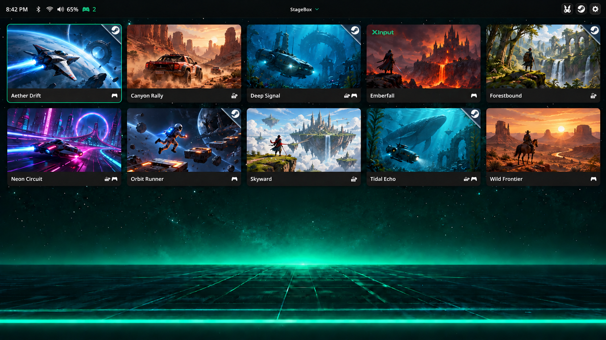

# StageBox

**Your games. Your controller. Your place to play.**

Give your Windows gaming PC a home that feels made for the big screen. StageBox
brings your games into a fullscreen library: pick something with your controller,
start playing, and come back to your library when you're done.

*AI-assisted illustration based on the current interface, with fictional example
games. This is a visual preview, not a Windows screenshot.*

## Settle in and play

- **Your games, together.** Installed Steam games appear automatically alongside
  the other Windows games you add. Browse the covers and choose what to play.
- **Controller in hand.** Navigate the library, check your buttons, and save a
  layout that feels right. Optional Xbox-style input helps with games that need it.
- **Steam, one button away.** Open Big Picture from the top bar, or launch an
  installed Steam game straight from its StageBox card. Steam handles its updates
  and sign-in.
- **A doorway to RetroBat.** Jump into your retro collection through RetroBat,
  then quit it to return to StageBox. RetroBat takes care of the emulators and ROMs.
- **The little things stay close.** Change sound output, adjust volume, connect
  Wi-Fi, or pair a Bluetooth controller from the tools menu.
- **Make it your gaming space.** Use StageBox as a regular app, or set up a
  dedicated living-room PC or arcade cabinet with its optional Windows kiosk mode.

## Get started

StageBox is an early project for **Windows 10/11 x64**. Public Windows downloads
are not available yet. You can [build a Windows bundle on Linux](docs/development.md)
and copy it to your gaming PC.

With a Windows bundle ready:

1. Unpack the complete bundle into a folder on your Windows PC.
2. Follow the [quick setup](docs/installation.md) to choose your games folder.
   Installed Steam games are found automatically.
3. Open `stagebox.exe`, connect a controller, and pick a game.

Want StageBox to be your Windows welcome screen? The [optional kiosk setup](docs/installation.md#optional-kiosk-setup)
walks through that. Start with the regular app setup first.

## Make it yours

| What would you like to do? | Guide |
| --- | --- |
| Learn the controls | [Your first session](docs/getting-started.md) |
| Add games outside Steam | [Your game library](docs/game-library.md) |
| Set up or remap a controller | [Controllers](docs/features/controllers.md) |
| Use Xbox-style input | [Virtual Xbox input](docs/features/virtual-input.md) |
| Find Steam games and handle updates | [Steam](docs/features/steam.md) |
| Open your retro collection | [RetroBat](docs/features/retrobat.md) |
| Pair devices, change sound or connect Wi-Fi | [Settings](docs/features/settings.md) |

Looking for something else? Visit the [documentation hub](docs/README.md),
check [troubleshooting](docs/troubleshooting.md), or [tell us what happened](https://github.com/aetoledano/stagebox/issues).

## Help shape StageBox

Ideas, bug reports and contributions are welcome. StageBox is developed and
built on Linux, with release behavior validated on Windows. The
[development guide](docs/development.md) lists the required tools, links to their
installation guides, and explains how Wails builds the app.

See [Contributing](CONTRIBUTING.md) to get involved.

StageBox's original code is licensed under [GPL-3.0-only](LICENSE).
Third-party components and artwork have their own [notices](THIRD_PARTY_NOTICES.md).
