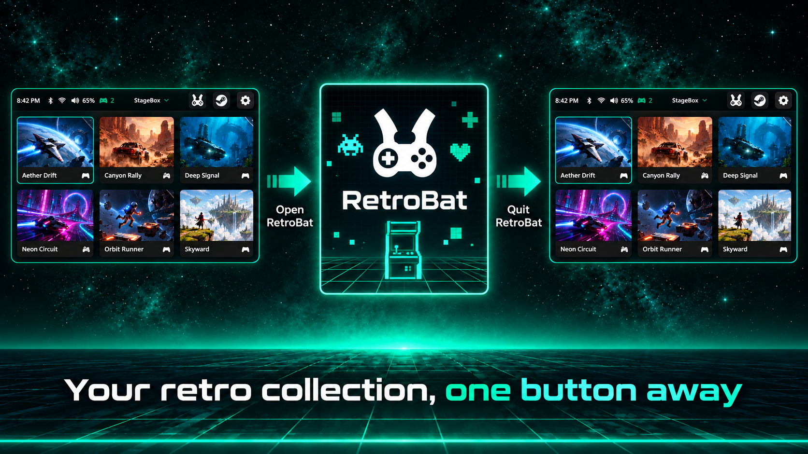

# RetroBat

[Documentation](../README.md) · [StageBox](../../README.md)

*Guide illustration with fictional example games; annotations are not app controls.*

Open RetroBat from the top bar, play through its EmulationStation library, then quit RetroBat to return to StageBox. RetroBat manages the emulators, ROMs and its own controller settings. StageBox opens the frontend rather than importing ROMs into its game grid.

## Setup and session behavior

Use the RetroBat-logo button beside Steam in the top bar. Controller/keyboard navigation reaches it like the other topbar buttons. If RetroBat is missing, StageBox downloads the latest stable Windows 64-bit setup from [RetroBat's official releases](https://github.com/RetroBat-Official/retrobat/releases/latest), shows download progress, and runs the installer. Finish setup using the [official installation guide](https://wiki.retrobat.org/get-started/installation-and-first-startup), then press the button again to open RetroBat. Installation discovery refreshes on each press, including installations such as `D:\RetroBat`, so a StageBox restart is not required after setup. For a portable/custom location that is not found automatically, set `retrobatPath` in StageBox's `config.json` and restart StageBox.

With no configured path, StageBox checks `RETROBAT_PATH`, current-user and machine Windows App Paths/uninstall records in both registry views, `RetroBat` folders at the root of fixed/removable local drives (including `C:\RetroBat` and `D:\RetroBat`), Program Files/Local AppData, a `RetroBat` folder beside `stagebox.exe`, and `RetroBat.exe` on `PATH`. Network/CD drives and recursive disk scans are excluded. Discovered files must exist; stale registry entries are skipped. An explicit config/environment path is authoritative: a missing installation offers setup instead of opening another installation, while invalid executable names and access errors show a dismissible error.

The installer is saved as `cache/installers/RetroBatSetup.exe`. Downloads use temporary files and are checked against the official release's file size and Windows executable header before setup starts; failures remove partial files and preserve a previous completed download. Setup starts directly, with the same Explorer fallback used for Steam installers. StageBox stays visible while setup runs independently; the cursor is made visible for setup. Installation is interactive and does not automatically launch RetroBat afterward.

StageBox starts an installed `RetroBat.exe` from its installation folder, pauses launcher navigation, restores the normal cursor, and hides its window. RetroBat manages the ROM library, themes, overlays, emulator setup, controller mappings and emulator exit hotkeys. Returning from a game to EmulationStation keeps StageBox hidden; quit RetroBat to return to StageBox with fullscreen, focus, and input restored. Download, setup-start and session failures use the existing launch-error panel.

The Windows session tracks the launched process group, including EmulationStation and inherited emulator children, rather than ending when the bootstrap executable exits or the frontend hides during gameplay. A lingering child/helper keeps the session active until it exits. Processes launched by an unrelated broker, with elevation, or outside the group are not guaranteed to be tracked. If this RetroBat installation is already running outside StageBox, quit it first; StageBox refuses an untracked handoff. Closing StageBox leaves RetroBat running. StageBox's Start+Back game-kill action does not terminate RetroBat; use RetroBat's own exit controls.

This integration launches the RetroBat frontend; it does not import ROM cards. StageBox uses SDL3 for its own controller input. Controllers saved as Virtual Xbox are passed through StageBox’s SDL-to-Xbox bridge for the entire RetroBat session; Native controllers stay native. See [Controllers](controllers.md) and [Virtual Xbox input](virtual-input.md).

## Controllers and multiplayer

Choose Native or Virtual Xbox per controller in StageBox. Custom SDL mapping overrides force Virtual Xbox so RetroBat receives the corrected layout. Native XInput pads stay native; the native-game card's virtual-input switch does not apply to RetroBat. Connect the intended controllers before opening RetroBat, because the converted roster stays fixed until the session ends.

The current bridge supports at most four converted pads and requires a free XInput slot for each. Native XInput pads share those four slots: two virtual plus two native XInput pads can fit, but four virtual plus four native XInput pads cannot. Four virtual plus four Native DirectInput/HID pads is a possible configuration to investigate, not verified eight-player support. USB/Bluetooth describes the connection, not the input API.

RetroBat detecting a controller does not guarantee that every emulator supports it or assigns the intended player. Emulator input drivers, player assignments, multitap settings and the game's player limit also matter; see [RetroBat's controller configuration](https://wiki.retrobat.org/controllers/controller-configuration).

StageBox does not set `SDL_JOYSTICK_RAWINPUT` for RetroBat. Enabling Raw Input does not remove this bridge's four-controller limit, and it can expose converted physical pads alongside their replacements because [HidHide cannot block Raw Input](https://docs.nefarius.at/projects/HidHide/FAQ/). Options for supporting more converted controllers remain [development research](../../CODEX.md#retrobat-controller-routing-and-multiplayer-research).

Known pending issue: RetroBat's emulator-install confirmation can require keyboard input with a Native DirectInput pad, even when that pad navigates the frontend correctly.
