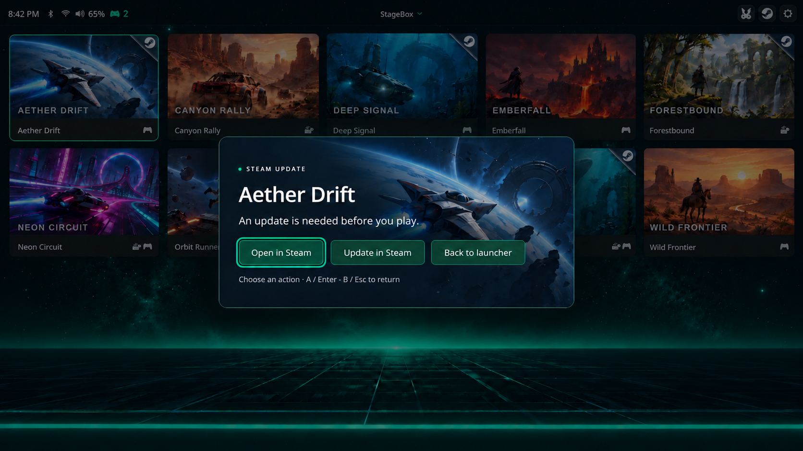

# Steam

[Documentation](../README.md) · [StageBox](../../README.md)



*Illustrative preview with example data, based on the current interface.*

Your installed Steam games join the StageBox library automatically, including games on other Steam library drives. Pick a game from the same grid as your other games, or use the Steam button for Big Picture.

After installing or removing a Steam game, choose **Tools → Reload Games**. Steam still handles sign-in, updates and first-run setup. Direct Steam game-card launches currently require internet access.

## Library discovery and launch behavior

StageBox automatically finds Steam through its Windows installation registry entries, `STEAM_PATH`/`STEAM_DIR`, or standard Program Files locations. It scans Steam's configured library folders and adds games with a fully installed manifest and files present on disk. Uninstalled games, unfinished downloads, and Steamworks redistributables are excluded. Available offline Steam metadata also filters out tools and supplies the card icons: full controller support shows a controller, partial support shows controller and keyboard/mouse, and no declared support shows keyboard/mouse. Missing metadata leaves icons hidden. Reload the launcher after installing or removing games.

Steam cards have a folded upper-right corner with the Steam logo. Cards use Steam's local artwork cache first, including newer content-hash folders. Missing artwork is downloaded from Steam and cached for later offline use; if artwork is unavailable, the game remains listed with a Steam icon. No account API key is required.

Every Steam game card launches with one command: `Steam.exe -gamepadui -fullscreen steam://run/<AppID>`. Steam handles its controller interface, sign-in, first-run agreements, updates and game startup. StageBox does not bootstrap or restart the client, check client/DLL registration, or choose a separate silent launch path. The panel shows **Launching Steam…** until the verified Steam interface or selected game takes over.

When a known update is needed, the panel offers **Open in Steam**, **Update in Steam**, and **Back to launcher**. Open in Steam uses the same game command and queues Play after the update. Update in Steam opens the game's library page without requesting Play: select Steam's Update button, then exit Big Picture (or hold Start+Back while no game has started) to return and play something else. StageBox never auto-launches after download completion in this mode and does not change Steam's download-while-playing settings. Closing Big Picture does not cancel a Play request already queued in Steam.

Steam's interface or a recognized setup dialog can stay open through a long download or setup. A client that never shows an interface has a two-minute startup grace. Once the selected game has a real window, StageBox follows only that game's processes using a dedicated Job Object and native handles. Start+Back stops the game without closing Steam or other games. After game exit, confirmed empty processes return after 750ms; live windowless processes retain a ten-second handoff grace.

For recognized foreground desktop Steam dialogs, the controller's left stick/D-pad moves the pointer, A clicks, and B sends Escape. Pointer fallback stops when the dialog loses focus or the game starts. Some external installers or Windows elevation prompts may still require a physical mouse/keyboard.

After a Steam card session ends, StageBox hides remaining client windows, asks Steam to leave Big Picture when that window exists, and reclaims native foreground focus before resuming launcher input. A brief background watcher hides late Steam UI; opening Steam again cancels it so Big Picture can reopen normally. Steam remains running for downloads and other background work. The topbar Steam button explicitly opens fullscreen Big Picture, including when Steam already runs in the tray; no persistent Steam settings are changed.

Steam cards show a white update icon before the title when the local Steam manifest reports an update is needed. The status refreshes every 15 seconds and after a session. Steam’s own interface shows download/install progress. StageBox logs manifest counters while starting; those are coarse snapshots that Steam may leave unchanged for minutes. This reflects updates already known to Steam; Steam may discover additional updates at launch.

Steam card launches require internet access. If StageBox cannot verify access, it keeps the launcher visible and shows an internet-required message; dismiss it with controller A/B/Start or Enter/Escape. Local games and the topbar Steam button retain their existing behavior.

## Per-game Steam settings

On first discovery, StageBox creates `gamesRoot/SteamGames/<AppID>-lc.json` with the game name and defaults. Edit that file to override cursor/input settings, for example:

```json
{
  "steamAppId": 570,
  "name": "Dota 2",
  "showCursor": false,
  "controls": 0,
  "waitAfterExitSeconds": 0,
  "delayedKey": null,
  "keyMap": null
}
```

Keep `steamAppId` unchanged. Supported settings are `name`, `description`, `image`, `controls`, `showCursor`, `waitAfterExitSeconds`, `delayedKey` and `keyMap`, with cursor/input fields using the same meanings as [local game settings](../game-library.md). Relative custom images resolve from the `SteamGames` folder. Omit a field to inherit its discovered default; explicit `false` and `0` override defaults. Steam manages launch options and StageBox retains its game-specific advanced tracking.

`steamSetup` is no longer supported. Remove that property from existing configs; unsupported fields cause a launch error. Every Steam game uses the same Big Picture command.

Existing files are never rewritten. Cursor/input edits apply on the next launch; reload StageBox to refresh card title/artwork/control edits. Configs are removed after uninstall and launcher reload when their manifests are absent. Downloading games, unavailable drives, missing Steam, or incomplete scans keep your files. Invalid configs remain on disk and show an error at launch.

Steam game tracking attaches after Steam creates the game process. Games started entirely through unrelated external brokers or protected/elevated processes can need additional tracking support; job assignment failures are logged and use handle tracking where possible. Check `stagebox.log` when a Steam game returns to the launcher unexpectedly.

Game crash-reporting helpers remain tracked for Start+Back cleanup, but their windows and process lifetime do not count as the game opening or staying active. A Crashpad helper can be present during normal play; its presence alone is not a crash diagnosis.

## Topbar Steam session tracking

The topbar Steam session follows existing and replacement clients from the same executable path and Windows session. After Big Picture appears, StageBox returns after 750ms without Big Picture/game windows when no tracked game process remains; full Steam shutdown uses a 1.5-second debounce. Windowless live game processes retain a ten-second handoff grace. Closing to the tray or exiting Big Picture into desktop Steam also returns to StageBox. Remaining client windows are hidden and StageBox reclaims foreground focus before input resumes. Sign-in/update windows remain usable during startup, with a two-minute limit if a live client shows no interface. Steam is not placed in a Job Object and its kill-shortcut behavior is unchanged. Mid-session client restarts or completely empty game handoffs taking longer than the short debounce, changed Steam window identities, or games started through unrelated processes may need further tracking adjustments.
