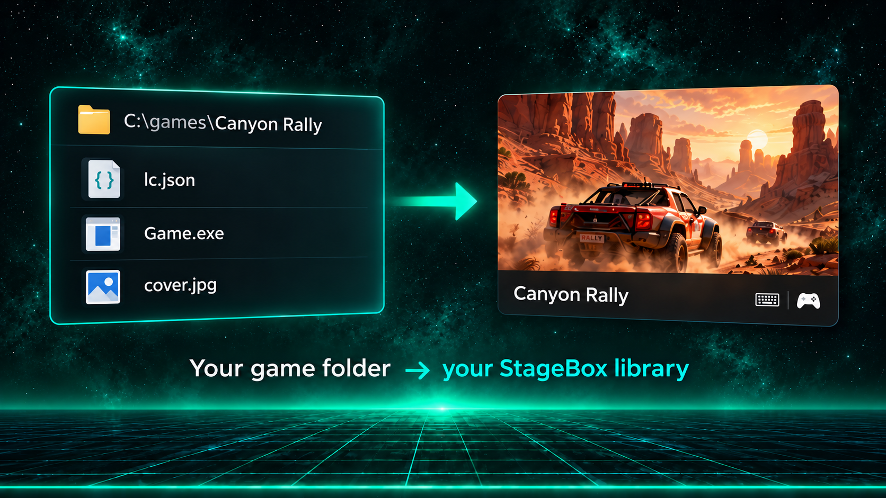

# Add your own games

[Documentation](README.md) · [StageBox](../README.md)



*Guide illustration with fictional example games; annotations are not app controls.*

Installed Steam games appear automatically. For other Windows games, add a small `lc.json` file alongside each game to tell StageBox what to launch and which cover to show.

StageBox scans the immediate subfolders under `gamesRoot`. Each game folder must contain an `lc.json` file.

Example:

```text
C:\games
  Halo
    lc.json
    Halo.exe
    cover.jpg
  Racing Game
    lc.json
    game.exe
    artwork.png
```

Minimal `lc.json`:

```json
{
  "name": "Halo",
  "executable": "Halo.exe",
  "image": "cover.jpg"
}
```

Fuller example:

```json
{
  "name": "Modern Warfare 3",
  "description": "Optional description",
  "executable": "Game.exe",
  "args": ["-fullscreen"],
  "startsOn": ".",
  "image": "cover.jpg",
  "controls": 2,
  "trackMode": "processTree",
  "advancedTracking": false,
  "waitAfterExitSeconds": 1,
  "showCursor": false,
  "enableVirtualInput": false,
  "delayedKey": {
    "seconds": 4,
    "key": "Enter"
  },
  "keyMap": {
    "mouse": "rightStick",
    "mouseSensitivity": 10,
    "buttons": {
      "A": ["Space", "Enter"],
      "B": ["Escape"],
      "RT": ["MouseLeft"]
    },
    "leftStick": {
      "up": ["W"],
      "down": ["S"],
      "left": ["A"],
      "right": ["D"]
    }
  }
}
```

Supported image inputs include JPEG, PNG, GIF, WebP, and AVIF. StageBox generates cached JPEG thumbnails under `cache/thumbnails`.

Important metadata notes:

- JSON is strict. Unknown fields will make that game fail to load.
- `id` is optional. If omitted, StageBox creates a deterministic UUID from the game name or folder name.
- Relative `executable`, `image`, and `startsOn` values are resolved from the game folder.
- `controls` controls the card icons: omit or use `0` for controller, `1` for keyboard/mouse, and `2` for both.
- `trackMode` can be omitted or set to `process` for normal process waiting. Use `processTree` for launchers that spawn the real game as a child process.
- `advancedTracking` is optional and defaults to `false`. Set it to `true` on Windows for games whose launcher exits before the real game: StageBox attaches the initial executable to a Job Object before it runs, follows its child processes, and makes the kill shortcut terminate the group. It overrides `trackMode` for that game. A 30-second window-start/handoff grace and a 2-second window-free quiet period prevent invisible helpers from keeping the session open indefinitely; `waitAfterExitSeconds` adds a final delay. It cannot track a game started by an unrelated external service or already-running launcher. Disable it if a game is incompatible with Job Objects. Closing StageBox does not automatically kill the group.
- `showCursor` should be enabled for games or launchers that need the Windows cursor visible.
- `enableVirtualInput` is optional and defaults to `false`. Enable it manually for native games that require XInput; the card menu saves this field and launch re-reads it without requiring a library reload.
- `keyMap` maps gamepad input to keyboard or mouse input while the game is running. See [`keypad-sample.json`](../keypad-sample.json) for a working sample.

For automatic discovery, see [Steam](features/steam.md). For controller conversion, see [Virtual Xbox input](features/virtual-input.md).
